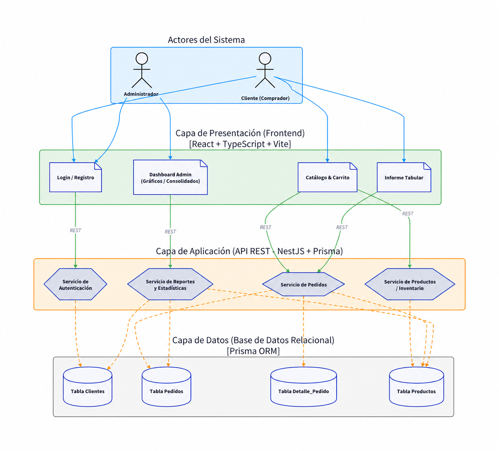

# Proyecto Final SW2

Tienda de ropa unisex (camisas, pantalones y buzos en tallas S, M, L y XL) con catálogo, carrito, pedidos e informes para el administrador.

# Diagrama de arquitectura



## Estructura del monorepo

```
SW2_ProyectoFinal/
├── frontend/            # React + TypeScript + Vite
├── backend/             # API REST NestJS + Prisma
│   └── prisma/
│       ├── schema.prisma    # Modelo de datos
│       ├── migrations/      # Migraciones SQL
│       ├── seed.ts          # Carga de datos iniciales
│       └── seed-data.ts     # Usuarios, productos y pedidos de prueba
├── docker-compose.yml   # db + backend + frontend
└── .env.example
```

## Tecnologías

| Capa | Tecnologías |
| --- | --- |
| Frontend | React 19, TypeScript, Vite, React Router, Axios, React Hook Form + Zod, Vitest |
| Backend | NestJS 10, Prisma 7, Passport + JWT, bcrypt, class-validator, Jest |
| Base de datos | PostgreSQL 18 |
| Infraestructura | Docker Compose, npm |

## Requisitos

- Docker y Docker Compose (opción recomendada), **o**
- Node.js 22+ y npm, más un PostgreSQL local

## Cómo ejecutar el proyecto

### Opción 1: Docker (todo con un comando)

```bash
git clone <URL_DEL_REPO>
cd SW2_ProyectoFinal
docker compose up --build
```

- Frontend: http://localhost:5173
- Backend: http://localhost:4000/api
- PostgreSQL: `localhost:5432` (usuario `sw2`, clave `sw2password`, base `sw2`)

Al arrancar, el backend aplica las migraciones y carga la seed automáticamente.
Si ya tienes otro servicio en el puerto 5432 o 5173, copia `.env.example` a `.env` y cambia `DB_PORT` o `FRONTEND_PORT`.

| Comando | Acción |
| --- | --- |
| `docker compose up --build` | Levantar todo |
| `docker compose down` | Detener |
| `docker compose down -v` | Detener y **borrar la base de datos** |
| `docker compose logs -f backend` | Ver logs del backend |
| `docker compose exec backend npm run prisma:seed` | Volver a cargar la seed |


## Cada vez que se vaya a trabajar (Flujo Git)

1. Traer lo último de main:
   ```bash
   git checkout main
   git pull origin main
   ```

2. Agregar los archivos modificados:
   ```bash
   git add .
   ```

3. Hacer el commit:
   ```bash
   git commit -m "descripción del cambio"
   ```

4. Subir a GitHub:
   ```bash
   git push origin main
   ```

## Usuarios de prueba (seed)

| Rol | Email | Contraseña |
| --- | --- | --- |
| Cliente | cliente1@correo.com | password123 |
| Cliente | cliente2@correo.com | password123 |
| Admin | admin@correo.com | adminpassword |

La seed también crea 9 productos y 12 pedidos históricos (6 por cliente). Se puede correr varias veces sin duplicar datos.

Cómo correrla, modificarla y reiniciar la base de datos, además de migraciones, Prisma Studio y problemas frecuentes: ver la **[guía del backend](backend/README.md)**.

## Base de datos

Tablas (ver `backend/prisma/schema.prisma`):

- **usuarios**: clientes y administradores (`rol`: `cliente` | `admin`), contraseña con bcrypt.
- **productos**: catálogo. `imagen` es una URL o el nombre de un archivo en `frontend/src/assets/productos`.
- **pedidos**: cabecera del pedido (cliente, fecha, total, estado).
- **detalle_pedido**: líneas del pedido (producto, talla, cantidad, precio de compra y subtotal).

Para cambiar el modelo:

```bash
cd backend
# editar prisma/schema.prisma
npx prisma migrate dev --name descripcion_del_cambio
```

## API REST

Todas las rutas usan el prefijo `/api`. Las rutas protegidas requieren el header `Authorization: Bearer <token>`.

| Método | Ruta | Acceso | Descripción |
| --- | --- | --- | --- |
| POST | `/auth/register` | Público | Crea una cuenta de cliente → `{ token, user }` |
| POST | `/auth/login` | Público | Inicia sesión → `{ token, user }` |
| GET | `/auth/me` | Autenticado | Usuario actual |
| GET | `/productos?categoria=Buzos` | Público | Catálogo (filtro opcional) |
| GET | `/productos/:id` | Público | Detalle de un producto |
| POST | `/productos` | Admin | Crear producto |
| PATCH | `/productos/:id` | Admin | Editar producto |
| DELETE | `/productos/:id` | Admin | Desactivar producto (borrado lógico) |
| POST | `/pedidos` | Cliente | Crear pedido: `{ items: [{ productoId, talla, cantidad }] }` |
| GET | `/pedidos/mios` | Cliente | Pedidos del cliente |
| GET | `/pedidos` | Admin | Todos los pedidos |
| GET | `/pedidos/:codigo` | Dueño o admin | Detalle (`PED-1001`) |
| PATCH | `/pedidos/:codigo/estado` | Admin | `{ estado: "Pendiente" \| "En proceso" \| "Enviado" \| "Completado" }` |
| GET | `/reportes/clientes-compras?pagina=1&porPagina=5` | Admin | Informe 1: tabular paginado |
| GET | `/reportes/productos` | Admin | Informe 2: consolidado por producto |
| GET | `/reportes/resumen` | Admin | Informe 3: resumen general |
| GET | `/health` | Público | Estado del servicio |

El backend calcula precios y totales con el catálogo; nunca confía en el precio que envía el frontend.

## Tests

```bash
cd backend && npm test     # Jest
cd frontend && npm test    # Vitest
```
